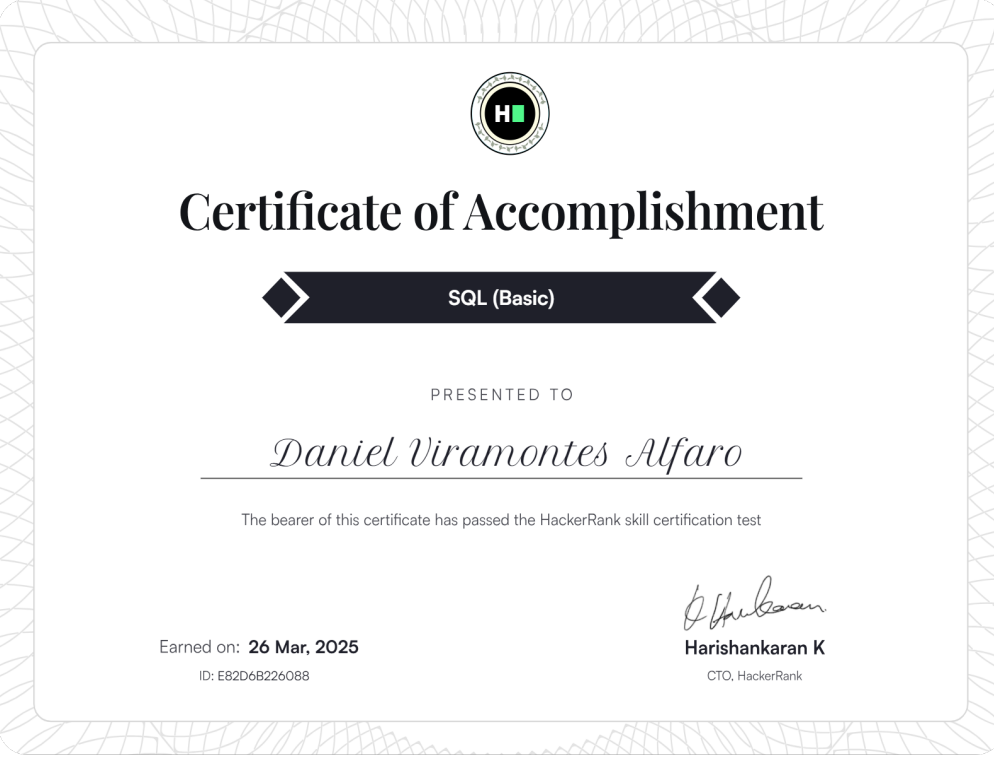
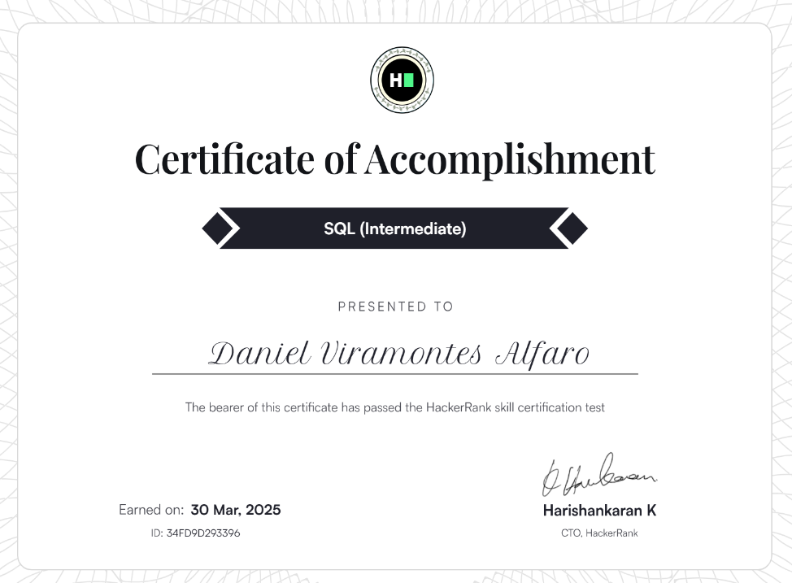
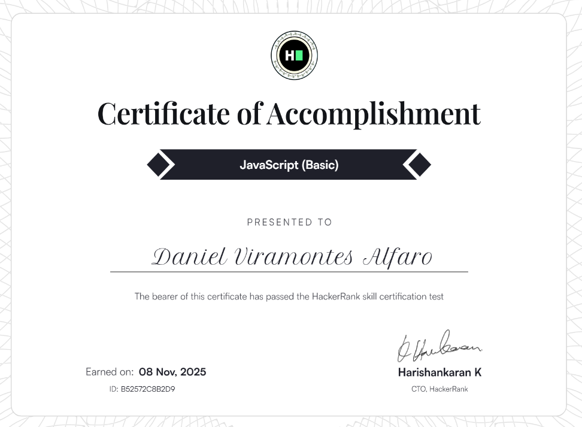
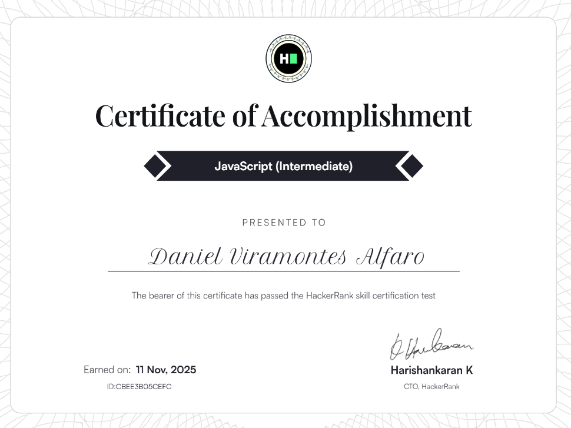
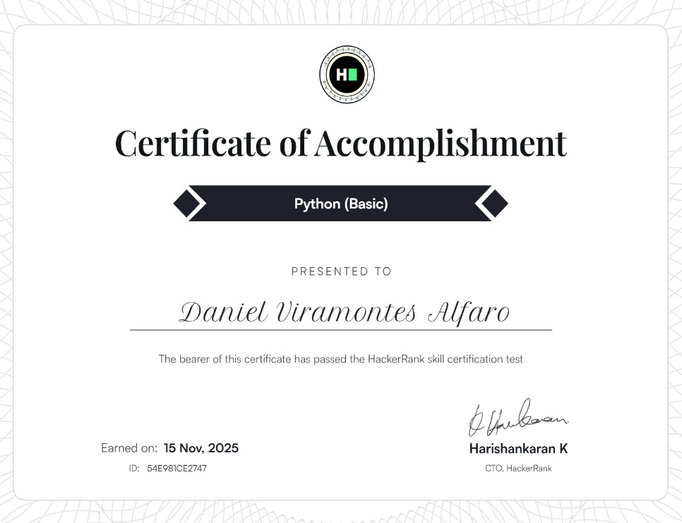
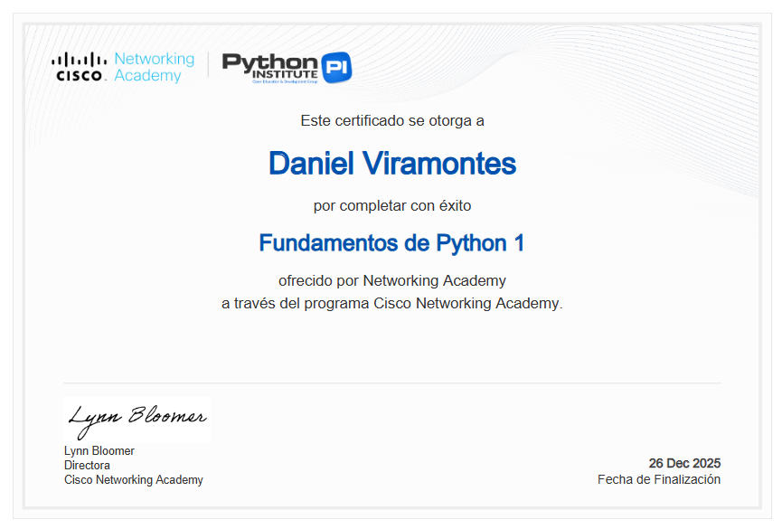
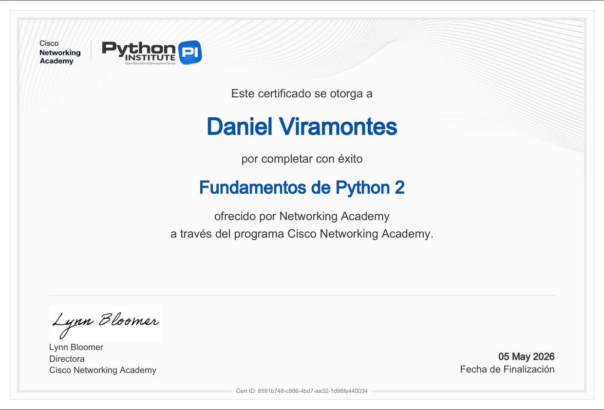
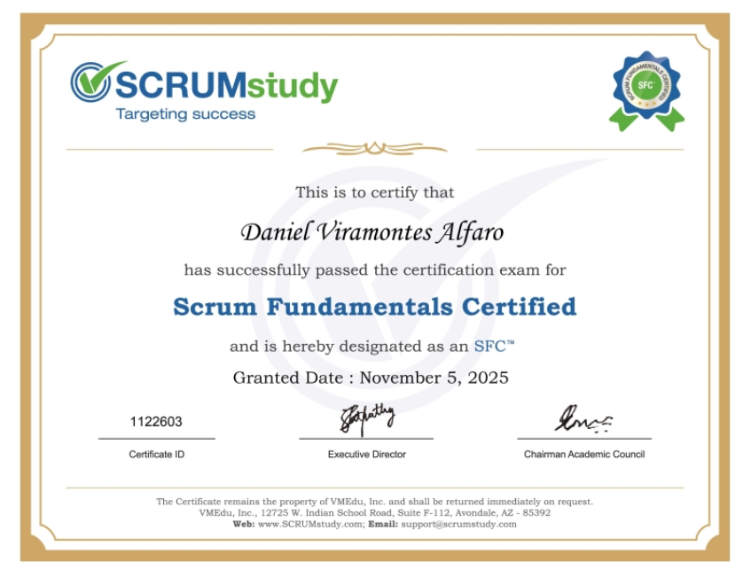
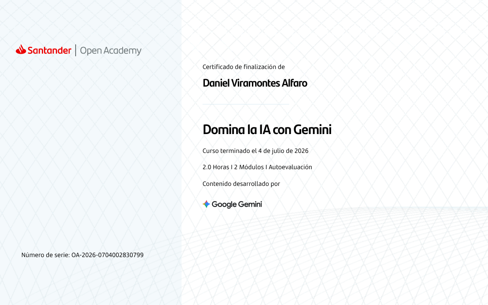

# Hola, soy Daniel

## Sobre mí
Soy estudiante de **nivel superior**, estudiante en **Ingeniería en Sistemas**.  
Actualmente me encuentro en proceso de formación en programación y desarrollo de software, fortaleciendo mis bases en lógica computacional, desarrollo web y manejo de bases de datos.

Este perfil refleja mi aprendizaje académico y proyectos prácticos conforme avanzo en mi preparación profesional.

---

## Intereses profesionales
- Desarrollo de software
- Programación y lógica computacional
- Desarrollo web
- Bases de datos
- Ingeniería en sistemas
- Aprendizaje continuo de tecnologías

---

## Conocimientos y tecnologías
*(En formación)*

### Lenguajes de programación
- JavaScript  
- Python
- SQL
- CSS
- C# (Aprendiendo actualmente)

### Desarrollo web
- HTML  
- CSS
- JavaScript (JS)

### Backend
- Node.js  
- Express  

### Bases de datos
- MySQL

### Control de versiones
- Git  
- GitHub  

---

## Proyectos
En este repositorio comparto proyectos académicos y personales enfocados en:

- Práctica de programación
- Desarrollo de sistemas web
- Ejercicios de lógica
- Aplicación de buenas prácticas básicas

Cada proyecto representa una etapa de mi aprendizaje y crecimiento técnico.

---

## Actualmente aprendiendo
- Mejora de lógica de programación
- Estructuración de proyectos backend
- Buenas prácticas en desarrollo web
- Trabajo con frameworks y entornos de desarrollo

---

## Objetivo académico y profesional
Mi objetivo actual es integrarme al ámbito profesional del desarrollo de software, ya sea aportando valor como becario dentro de una empresa tecnológica o gestionando proyectos independientes como freelancer. Busco aplicar mis conocimientos técnicos en entornos reales y continuar expandiendo mis habilidades.

---

## Certificaciones

<strong> SQL (Básico) </strong>

Visitar certificado: https://www.hackerrank.com/certificates/e82d6b226088

<strong> SQL (Intermedio) </strong>

Visitar certificado: https://www.hackerrank.com/certificates/34fd9d293396

<strong>JavaScript (Básico) – HackerRank</strong>

Visitar certificado: https://www.hackerrank.com/certificates/50dc9875c06a

<strong>JavaScript (Intermedio) – HackerRank</strong>

Visitar certificado: https://www.hackerrank.com/certificates/cbee3b05cefc

<strong> Python (Básico) </strong>

Visitar certificado: https://www.hackerrank.com/certificates/54e981ce2747

<strong> Python Essentials (Cisco - Básico) </strong>

Visitar certificado (Para ver el PDF de este certificado, deberá ingresar a la carpeta de certificaciones que está en este mismo repositorio): Certificaciones/Python_Essentials_1_certificate.pdf

<strong> Python Essentials (Cisco - Intermedio) </strong>

Visitar certificado (Para ver el PDF de este certificado, deberá ingresar a la carpeta de certificaciones que está en este mismo repositorio): Certificaciones/Python_Essentials_2_certificate.pdf

<strong> ScrumFundamentals </strong>

Visitar certificado: https://www.scrumstudy.com/certification/verify?type=SFC&number=1122603

<strong> IA con Gemini (Santander Open Academy) </strong>

Visitar certificado (Para ver el PDF de este certifiado, debera ingresar a la carpeta de certificaciones que esta en este mismo repositorio): Certificaciones/certificadoGeminiSantanderOpenAcadademy.pdf

## Nota
Este perfil se encuentra en constante actualización conforme avanzo en mi formación académica y técnica.  
Estoy abierto a aprender, mejorar y recibir retroalimentación.
